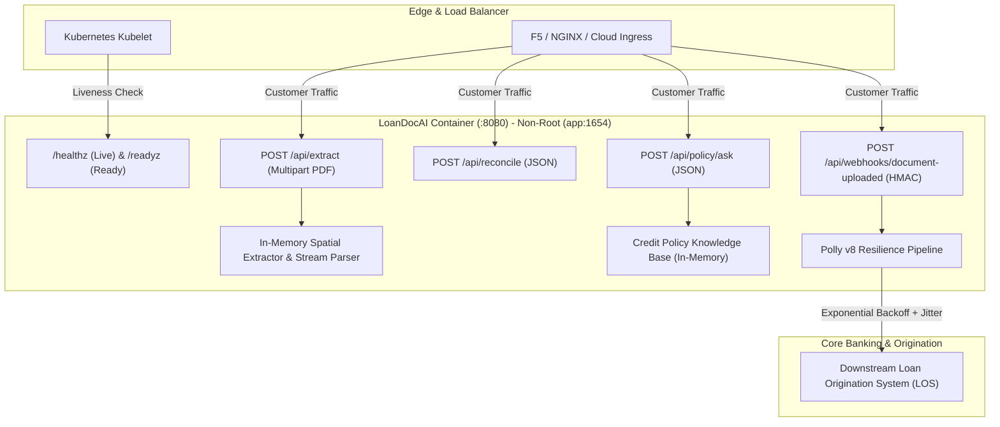

# LoanDocAI: Production Operations Runbook & SRE Guide 📖

This document serves as the formal **Forward Deployed Engineer (FDE) Hand-off & Standard Operating Procedure (SOP)** for partner banks, NBFC DevOps, and Site Reliability Engineering (SRE) teams managing LoanDocAI in production.

---

## 1. System Architecture & Topology

LoanDocAI operates as a stateless, containerized document intelligence and policy verification microservice.



---

## 2. Quickstart & Deployment

### 2.1 Single-Command Docker Compose (Local / Staging)

To build and spin up the hardened container from a cold start:

```bash
# Clone and build
git clone https://github.com/pranavkawale22/LoanDocAI.git
cd LoanDocAI

# Launch container in background
docker compose up -d --build

# Verify container status and health
docker compose ps
docker compose logs -f
```

The service will be accessible at:
- **Operator Dashboard:** [http://localhost:8080/](http://localhost:8080/)
- **Liveness Probe:** [http://localhost:8080/healthz](http://localhost:8080/healthz)
- **Readiness Probe:** [http://localhost:8080/readyz](http://localhost:8080/readyz)
- **API Documentation:** [http://localhost:8080/openapi/v1.json](http://localhost:8080/openapi/v1.json) *(Development mode)*

---

## 3. Configuration & Secrets Matrix

All runtime configuration is managed via environment variables adhering to the 12-factor application methodology:

| Environment Variable | Required | Default | Description |
| :--- | :---: | :---: | :--- |
| `ASPNETCORE_ENVIRONMENT` | Yes | `Production` | Runtime environment (`Production`, `Staging`, `Development`). |
| `ASPNETCORE_URLS` | Yes | `http://+:8080` | Internal listening port binding for the container. |
| `DOTNET_EnableDiagnostics` | No | `0` | Disables .NET debugging sockets to reduce container attack surface. |
| `Webhook__SecretKey` | Yes | *None* | Shared cryptographic secret used to validate partner HMAC-SHA256 headers. |
| `DownstreamLos__BaseUrl` | Yes | *None* | HTTP(S) endpoint for the core Loan Origination System (LOS). |
| `DownstreamLos__ApiKey` | Yes | *None* | API Key passed via `X-Api-Key` for downstream LOS dispatch. |

---

## 4. Kubernetes Production Deployment Specification

Deploying LoanDocAI into enterprise Kubernetes (EKS, GKE, AKS, OpenShift):

```yaml
apiVersion: apps/v1
kind: Deployment
metadata:
  name: loandocai-api
  namespace: lending-core
  labels:
    app.kubernetes.io/name: loandocai
    app.kubernetes.io/part-of: lending-platform
spec:
  replicas: 3
  strategy:
    type: RollingUpdate
    rollingUpdate:
      maxSurge: 1
      maxUnavailable: 0
  selector:
    matchLabels:
      app: loandocai
  template:
    metadata:
      labels:
        app: loandocai
    spec:
      securityContext:
        runAsNonRoot: true
        runAsUser: 1654
        runAsGroup: 1654
        fsGroup: 1654
      containers:
        - name: api
          image: loandocai:latest
          imagePullPolicy: IfNotPresent
          ports:
            - containerPort: 8080
              name: http
          envFrom:
            - secretRef:
                name: loandocai-secrets
            - configMapRef:
                name: loandocai-config
          resources:
            requests:
              cpu: "250m"
              memory: "128Mi"
            limits:
              cpu: "1500m"
              memory: "512Mi"
          # Liveness Probe: Restarts container if unhandled deadlock or crash occurs
          livenessProbe:
            httpGet:
              path: /healthz
              port: 8080
            initialDelaySeconds: 5
            periodSeconds: 15
            timeoutSeconds: 3
            failureThreshold: 3
          # Readiness Probe: Removes pod from load balancer pool if dependencies drop
          readinessProbe:
            httpGet:
              path: /readyz
              port: 8080
            initialDelaySeconds: 5
            periodSeconds: 10
            timeoutSeconds: 3
            failureThreshold: 2
```

---

## 5. Security & Zero-PII Compliance Guarantees

In compliance with Reserve Bank of India (RBI) Digital Lending Guidelines and global data privacy standards (GDPR / DPDP):

1. **Strict In-Memory Processing:**
   - Incoming PDF files (`POST /api/extract`) are streamed directly in memory and processed via `PdfPig` without ever being saved to container disks, temporary swap spaces, or persistent volumes.
2. **Zero-PII Telemetry:**
   - Loggers record request durations, document types, HTTP response status, and document hash digests. Under no circumstances are borrower names, bank account numbers, or salary amounts logged into standard out or external APMs.
3. **Timing-Attack Immune Webhook Verification:**
   - Webhook validation uses `CryptographicOperations.FixedTimeEquals` to prevent side-channel timing analysis attacks when verifying HMAC signatures.
4. **Hardened Minimal Runtime Container:**
   - Built on `aspnet:10.0-alpine` with an unprivileged non-root user (`USER app`, UID/GID 1654).

---

## 6. Incident Triage & Troubleshooting Playbook

### Scenario A: `/readyz` Returns 503 Service Unavailable
* **Symptom:** Kubernetes pods fail readiness checks; ingress returns 502/503.
* **Root Cause:** The credit policy file (`data/policies/credit_policy.json`) is missing, corrupt, or unreadable by `app` user.
* **Resolution:**
  1. Inspect container logs: `kubectl logs deployment/loandocai-api -n lending-core`.
  2. Verify policy mount directory: confirm file permissions are `chmod 644` and readable by UID 1654.

### Scenario B: 400 Bad Request on Extraction (`File size exceeds limit`)
* **Symptom:** Partner submits loan document and receives `400 Bad Request: File size exceeds 5 MB limit`.
* **Root Cause:** Defensive anti-DOS limit triggered.
* **Resolution:**
  - LoanDocAI strictly enforces a 5 MB maximum file size to protect memory pools from decompression bomb attacks. Request partner compress the PDF or verify the submitted file is a standard digital statement, not a raw 600 DPI scanner TIFF.

### Scenario C: 403 Forbidden on Webhook Ingestion
* **Symptom:** Partner broker webhooks receive `403 Forbidden`.
* **Root Cause:** HMAC-SHA256 signature mismatch or mismatched secret key.
* **Resolution:**
  1. Ensure partner computes HMAC over the exact raw body payload bytes:
     ```bash
     echo -n '<RAW_PAYLOAD>' | openssl dgst -sha256 -hmac '<SECRET_KEY>'
     ```
  2. Verify secret key in `Webhook__SecretKey` matches partner's provisioned key.

### Scenario D: Downstream LOS Rate Limiting / Flakiness
* **Symptom:** High request duration on automated LOS dispatch.
* **Root Cause:** Core banking API is degrading under load.
* **Mitigation:**
  - LoanDocAI's built-in **Polly v8** pipeline automatically applies exponential retry with jitter across 3 attempts. If failures persist, the circuit breaker opens to prevent flooding the upstream core bank.
