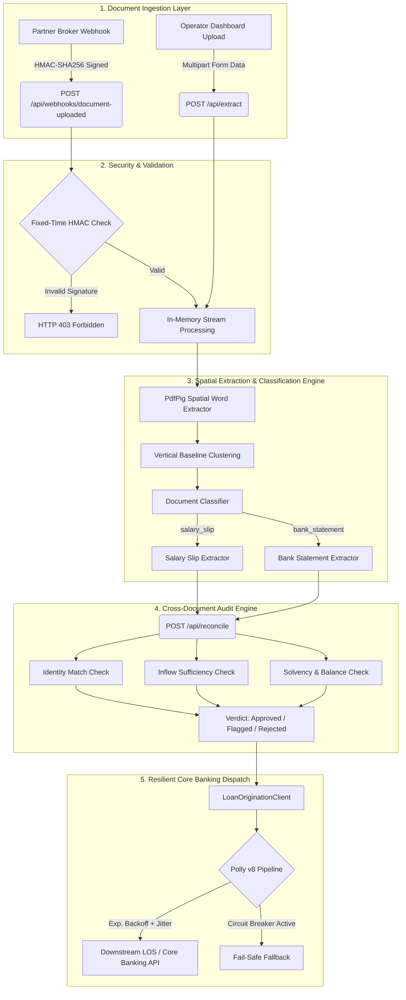

# LoanDocAI 🏦📄

[](https://dotnet.microsoft.com/)
[-emerald)](#automated-evaluation-benchmark)
[](#automated-evaluation-benchmark)
[](LICENSE)
[](https://github.com/pranavkawale22/LoanDocAI)

**LoanDocAI** is an enterprise-grade document intelligence and income verification engine engineered for digital lending operations. It automatically ingests, validates, and cross-reconciles unstructured Indian salary slips and bank statements (PDFs), reducing loan underwriter intake times from **3 days to under 30 seconds**.

Built with **.NET 10**, **C# 13**, **Polly v8**, and **Tailwind CSS** following strict Forward Deployed Engineering (FDE) principles.

---

## 🎯 Executive Overview & Business Value

In retail and MSME lending, loan officers spend 15–25 minutes per application manually typing income details from PDFs into a Loan Origination System (LOS) and cross-referencing bank credits. 

LoanDocAI solves this end-to-end:
1. **Defensive Extraction:** Extracts structured salary and bank fields across diverse Indian formats (`₹`, `Rs.`, `INR`, bare lakh notations, varied date styles, and ledger grids) with **100% benchmark accuracy**.
2. **Automated Fraud & Discrepancy Detection:** Cross-checks borrower identity, deposit inflow sufficiency, and account solvency buffer between documents.
3. **Enterprise Resilience & Security:** Cryptographic **HMAC-SHA256** webhook protection with constant-time equality checks and **Polly v8** exponential retry pipelines for flaky downstream banking APIs.
4. **Zero-PII Compliance:** In-memory stream processing with zero persistent document storage and strict PII redaction in logs to satisfy strict banking data governance.

---

## 🏗️ System Architecture



---

## 📊 Automated Evaluation Benchmark

In accordance with [SPEC.md](SPEC.md), an automated evaluation harness scores extracted fields against 20 deterministically generated synthetic documents (10 salary slips, 10 bank statements) across 3 layout variations and 4 currency styles:

```text
=================================================================
                   EVALUATION HARNESS REPORT                     
=================================================================
Total Documents Evaluated: 20
Overall Accuracy:          100.00%
-----------------------------------------------------------------
Accuracy by Document Type:
  - salary_slip       : 100.00%
  - bank_statement    : 100.00%
-----------------------------------------------------------------
Accuracy by Field:
  - applicant_name    : 100.00%
  - bank_name         : 100.00%
  - closing_balance   : 100.00%
  - document_type     : 100.00%
  - employer_name     : 100.00%
  - gross_salary      : 100.00%
  - net_salary        : 100.00%
  - opening_balance   : 100.00%
  - pay_month         : 100.00%
  - statement_from    : 100.00%
  - statement_to      : 100.00%
  - total_credits     : 100.00%
=================================================================
[PERFECT MATCH] All fields matched ground-truth with 100% accuracy!
```

---

## 🛠️ Tech Stack & Key Libraries

* **Core Framework:** .NET 10 (C# 13), ASP.NET Core Minimal APIs
* **PDF Layout Extraction:** `PdfPig` (Pure C#, cross-platform, zero unmanaged native dependencies)
* **Synthetic Ground-Truth Generator:** `QuestPDF` with embedded Google NotoSans fonts
* **Integration Resilience:** `Microsoft.Extensions.Http.Resilience` (Polly v8: Exponential Backoff, Jitter, Circuit Breaker)
* **Cryptographic Security:** `System.Security.Cryptography` (`HMACSHA256`, `CryptographicOperations.FixedTimeEquals`)
* **Operator Frontend:** Embedded HTML5, Tailwind CSS, FontAwesome, Vanilla JS
* **Test Suite:** xUnit, `Microsoft.AspNetCore.Mvc.Testing` (31 unit & integration tests)

---

## 🚀 Getting Started

### Prerequisites
* [.NET 10 SDK](https://dotnet.microsoft.com/download/dotnet/10.0) installed on your machine.

### 1. Clone the Repository
```bash
git clone https://github.com/pranavkawale22/LoanDocAI.git
cd LoanDocAI
```

### 2. Run the Test Suite
Run all 31 unit, integration, and benchmark tests:
```bash
dotnet test
```

### 3. Launch the API & Operator Dashboard
```bash
dotnet run --project src/LoanDocAI.Api
```

Open your browser to:
👉 **`http://localhost:5000`** (or the port displayed in your terminal).

You will see the interactive Lending Operations workstation where you can:
- Drop in any text-based PDF or click any of the pre-loaded quick test samples (`slip-01`, `stmt-01`, etc.).
- Inspect extracted income tables side-by-side.
- Click **"Run Verification Audit"** to see automated fraud/discrepancy reconciliation.
- Toggle between **Live API Mode** and **Offline Demo Mode** in the navigation bar.

---

## 🔌 API Reference

### 1. Document Extraction
Extract structured fields from a single text-based PDF.

```http
POST /api/extract
Content-Type: multipart/form-data
```

**cURL Example:**
```bash
curl -X POST http://localhost:5000/api/extract \
  -F "file=@data/synthetic/pdfs/slip-01.pdf"
```

**Response (Salary Slip):**
```json
{
  "document_type": "salary_slip",
  "applicant_name": "Harish Rao",
  "employer_name": "Orchid Textiles Ltd",
  "pay_month": "2026-01",
  "gross_salary": 119582.00,
  "net_salary": 106945.90
}
```

---

### 2. Cross-Document Income Reconciliation
Verify borrower identity match and reconcile declared salary against bank inflows.

```http
POST /api/reconcile
Content-Type: application/json
```

**Request Body:**
```json
{
  "salary_slip": {
    "applicant_name": "Harish Rao",
    "employer_name": "Orchid Textiles Ltd",
    "pay_month": "2026-01",
    "gross_salary": 119582.00,
    "net_salary": 106945.90
  },
  "bank_statement": {
    "applicant_name": "Harish Rao",
    "bank_name": "Sahyadri Cooperative Bank",
    "statement_from": "2026-01-01",
    "statement_to": "2026-01-31",
    "opening_balance": 25000.00,
    "closing_balance": 35000.00,
    "total_credits": 115000.00
  }
}
```

**Response:**
```json
{
  "status": "Approved",
  "confidence_score": 95,
  "checks": [
    {
      "check_name": "Applicant Identity Match",
      "passed": true,
      "details": "Names match exactly: 'Harish Rao'."
    },
    {
      "check_name": "Positive Net Salary",
      "passed": true,
      "details": "Declared Net Salary is positive (₹106,945.90)."
    },
    {
      "check_name": "Deposit Inflow Sufficiency",
      "passed": true,
      "details": "Monthly bank credits (₹115,000.00) adequately cover net salary (₹106,945.90)."
    },
    {
      "check_name": "Account Solvency",
      "passed": true,
      "details": "Positive closing balance maintained (₹35,000.00)."
    }
  ],
  "summary_notes": "APPROVED: Identity verified, salary validated against bank inflows, and healthy account solvency confirmed."
}
```

---

### 3. Partner Webhook Ingestion (HMAC-SHA256)
Ingest automated partner upload notifications protected with cryptographic signature headers.

```http
POST /api/webhooks/document-uploaded
X-Signature: <hmac-sha256-hex>
Content-Type: application/json
```

---

### 4. Credit Underwriting Policy Copilot (Grounded RAG)
Query institutional underwriting rules and credit guidelines with strict grounded citations and hallucination guardrails.

```http
POST /api/policy/ask
Content-Type: application/json

{
  "question": "What is the minimum net salary required for an applicant living in Pune (Tier-2)?"
}
```

**Response:**
```json
{
  "status": "Answered",
  "confidence_score": 92,
  "answer": "According to [Clause 1.1: Minimum Monthly Net Income Thresholds]:\nApplicants must demonstrate minimum verifiable net monthly salary credited via banking channels: (a) Tier-1 Metros: INR 25,000 per month; (b) Tier-2 Cities (Pune, Ahmedabad, Jaipur, Lucknow, Nagpur, Indore, Kochi, Surat): INR 20,000 per month; (c) Tier-3 and Other Locations: INR 18,000 per month. Cash salaries are strictly ineligible.",
  "citations": [
    {
      "clause_id": "Clause 1.1",
      "title": "Minimum Monthly Net Income Thresholds",
      "excerpt": "Tier-2 Cities (Pune, Ahmedabad, Jaipur, Lucknow, Nagpur, Indore, Kochi, Surat): INR 20,000 per month."
    }
  ]
}
```

*Note: Queries violating underwriting scope or touching unsupported assets (e.g. cryptocurrency collateral) are rejected with `status: "NotFound"` and zero confidence, preventing LLM/retrieval hallucinations.*

---

## 🔒 Security & Privacy (RBI / Compliance)

- **Strict In-Memory Processing:** Uploaded documents are read as streams and never persisted to local disk or unencrypted temporary directories.
- **Zero-PII Logging:** Application logs strictly record metadata (`application_id`, `document_type`, HTTP status codes, latency). Borrower names, PAN/Aadhaar references, and monetary figures are scrubbed from telemetry.
- **Timing-Attack Hardened:** All cryptographic comparisons utilize `CryptographicOperations.FixedTimeEquals` to prevent side-channel timing analysis.

---

## 📁 Repository Structure

```
LoanDocAI/
├── SPEC.md                             <- Production specification & evaluation criteria
├── README.md                           <- Enterprise architecture & user guide
├── LoanDocAI.sln                       <- .NET 10 solution file
├── src/
│   └── LoanDocAI.Api/
│       ├── Evaluation/                 <- Accuracy scoring harness
│       ├── Integration/                <- Downstream LOS client & Polly resilience
│       ├── Models/                     <- Extraction, Reconciliation & Policy DTOs
│       ├── Security/                   <- HMAC-SHA256 validator (constant-time)
│       ├── Services/                   <- Extractor, classifier, pattern parser, Policy QA RAG
│       ├── wwwroot/                    <- Embedded Operator Dashboard & Policy Copilot
│       └── Program.cs                  <- Minimal API endpoints & DI container
├── tests/
│   └── LoanDocAI.Tests/                <- 39 xUnit integration & benchmark tests
├── tools/
│   └── LoanDocAI.DataGen/              <- QuestPDF deterministic synthetic data generator
└── data/
    ├── policies/                       <- Institutional credit underwriting rules (JSON)
    └── synthetic/
        ├── pdfs/                       <- 20 synthetic test PDFs
        └── truth/                      <- 20 ground-truth JSON benchmark targets
```

---

## 📄 License
This project is licensed under the Apache 2.0 License - see the [LICENSE](LICENSE) file for details.
